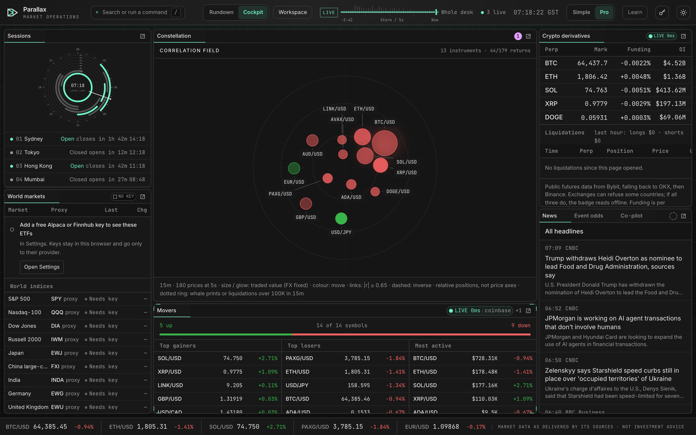
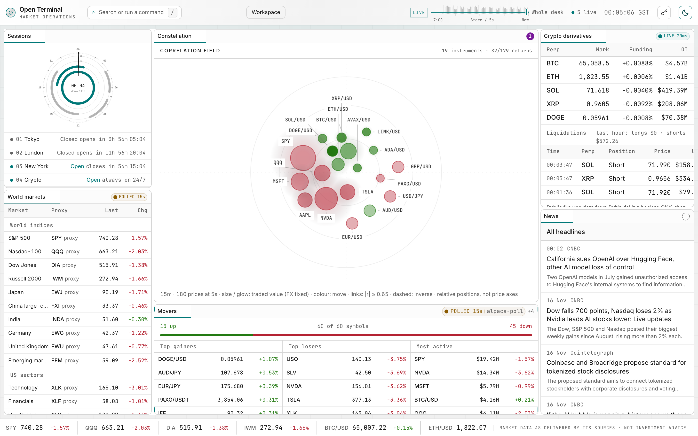
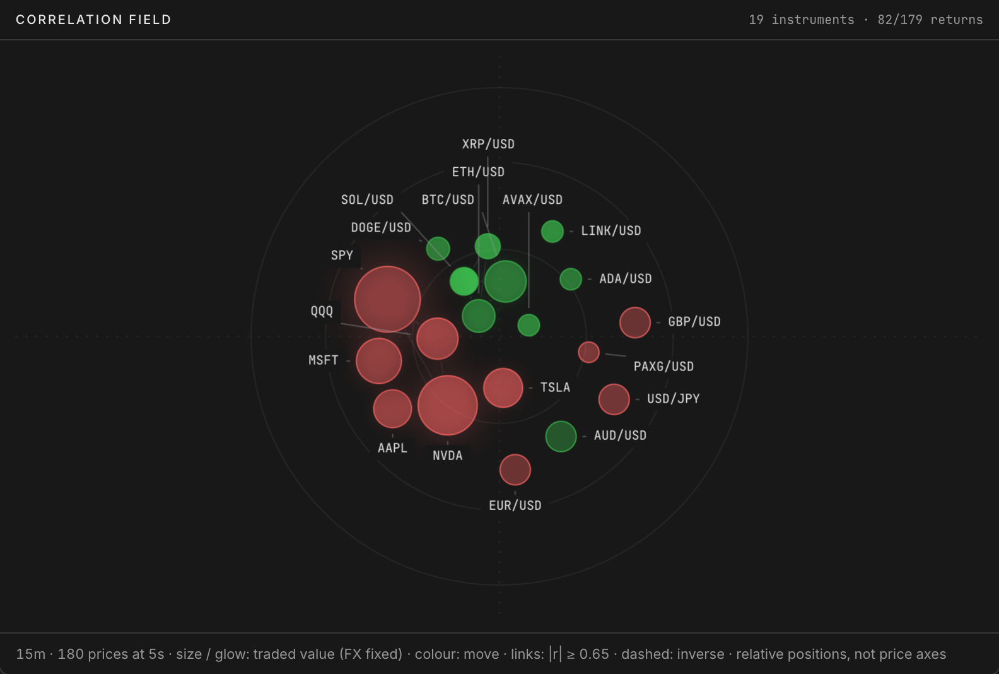
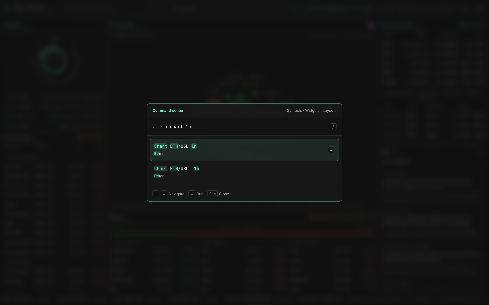
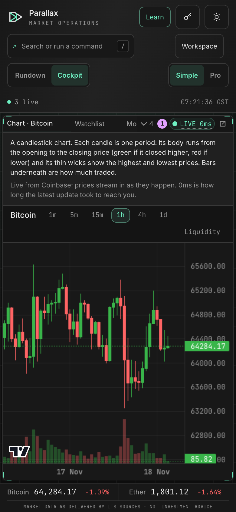

# Open Terminal

A free, open-source market terminal that runs entirely in your browser:
live crypto, FX, US stocks on your own key, rates and macro, news and
filings — in one dockable cockpit where every number shows its source and
its age.

**Live:** <https://open-terminal.pages.dev> — no account, no install. Crypto,
FX, perpetual futures, macro and news work the moment the page loads.

> Open Terminal shows market data as delivered by its public sources. It is
> not investment advice, and nothing here is guaranteed to be correct,
> complete or timely.

## Screenshots



|                                                                            |                                                      |
| -------------------------------------------------------------------------- | ---------------------------------------------------- |
|  |  |
|                            |            |

## What makes it different

- **Truth badges.** Every panel header carries a pill — `LIVE 140ms`,
  `POLLED 15s`, `EOD`, `NO KEY`, `RATE LIMITED`, `OFFLINE` — plus the source
  name. A panel fed by several feeds shows its worst one. No other free
  terminal is this honest about what it is showing you.
- **Constellation.** A living map instead of a tile grid: each instrument is
  a body sized by traded value and coloured by its move, and bodies drift
  together when their prices move together, from correlation computed live
  in your browser. Click a body and every linked panel follows.
- **Rewind.** The terminal keeps the last hour of everything it has seen.
  Drag the scrubber in the top bar and the whole desk — chart, book, tape,
  constellation, news — replays in sync. "What happened at 14:32?" is one
  drag.
- **Terminal as a link.** A workspace, its symbols and even a Rewind moment
  encode into the URL. Send the link; the other person opens your exact
  screen, live, with no account.
- **Market weather.** A faint glow behind the panels shifts from mint to
  orchid as your watchlist's short-term volatility rises. You sense the
  regime before you read a number.
- **Mission Control.** The default workspace: the constellation in the
  centre with sessions, world proxies, derivatives, breadth and headlines
  around it — the bridge of a ship, in chrome and mint, dark or light.
- **Command bar.** `/` or Ctrl+K anywhere: `aapl tape`, `btc chart 1h`,
  `news tesla`, `watch sol`, `layout macro`. Fuzzy, keyboard-only, results
  as you type.
- **Linked panels.** Each panel has a colour link dot; panels in one group
  follow the same symbol, so one click retargets chart, book and news
  together.
- **Event odds.** Market-moving events from Polymarket — central-bank
  decisions, inflation and jobs prints, elections, conflicts, tariffs, oil
  supply, shutdowns — grouped by theme and region, each beside the assets it
  moves (Fed odds next to the 2-year yield, gold and the dollar). Labelled
  for what they are: market odds, not forecasts.
- **Paper trading.** Trade from any stock or ETF chart with fake money on
  your free Alpaca paper account: market and limit orders, open orders,
  positions, profit and loss, cancel. Live trading is not possible in Open
  Terminal: the code can only reach Alpaca's paper environment.
- **Learn mode.** One switch explains the terminal for students and new
  traders: what each panel shows, what its badge means right now, and, on
  hover or focus, every number, column and label in plain words.
- **Co-pilot.** Ask in plain words — "why is BTC down?", "brief me on
  today" — and get an answer from the panels on your screen and recent
  headlines, with the panels and headlines it used listed beside it. It
  explains; it never tells you to buy or sell. It runs on your own
  Anthropic or OpenAI key, which stays in your browser and goes only to that
  provider.
- **Liquidity heatmap.** Turn on "Liquidity" on a crypto or FX chart to see
  where buy and sell orders have been resting, shaded behind the candles,
  for as long as the page has been watching the book.
- **Smart alerts.** Type `alert BTC above 65000` or `alert ETH down 2% in
15m` and get a browser notification, with the price, source and time,
  when it happens. Alerts run while Open Terminal is open in a tab.
- **Multi-screen.** The window button on any panel moves it into its own
  browser window for a second monitor. It stays linked and live, and follows
  your theme; one click brings it back.

## The honest part: what "free" and "no delay" allow

Free, tick-level data exists for crypto and for a slice of US stocks;
everything else is a live proxy, delayed or daily. Exchanges charge licence
fees for consolidated real-time feeds, and no free API gets around that.

| Asset class                                            | Free and live?                   | How we get it                                                                                                                | The catch                                                                                          |
| ------------------------------------------------------ | -------------------------------- | ---------------------------------------------------------------------------------------------------------------------------- | -------------------------------------------------------------------------------------------------- |
| Crypto spot, order book, trades                        | Yes, tick by tick                | Public WebSockets from Binance, Coinbase, Kraken. No key                                                                     | Binance is blocked in some countries; the app falls back to Coinbase or Kraken                     |
| US stocks and ETFs                                     | Yes, partly                      | Alpaca (IEX) or Finnhub WebSocket, on your own free key                                                                      | IEX is one exchange, not the full tape; volume is partial; Alpaca's free stream caps at 30 symbols |
| US options                                             | Indicative only                  | Alpaca's free indicative options feed, on your own free Alpaca key                                                           | Quotes adjusted from OPRA, trades 15 minutes late; IV and delta are Alpaca's model values          |
| US indices, world indices, sectors, bonds, commodities | No (TAIEX: daily close)          | Live ETF proxies (SPY, QQQ, EWJ, EWG, …) on the World markets, Europe and Asia-Pacific boards; TAIEX from Taiwan's open data | Labelled "proxy, US hours only"; official index levels need a licence from each index provider     |
| FX majors                                              | Yes, partly                      | Kraken spot pairs, live; ECB daily reference rates for ~30 currencies                                                        | Exchange price, not interbank; the ECB fixes once a working day                                    |
| Gold                                                   | Proxy only                       | PAXG gold token on crypto exchanges, live                                                                                    | Tracks spot gold closely; not the futures price                                                    |
| Perpetual futures                                      | Yes                              | Bybit, with OKX and Binance futures as fallbacks: funding, mark, open interest, liquidations                                 | USDT-margined perps; some exchanges refuse US visitors                                             |
| Rates and macro                                        | Daily, which is how they publish | US Treasury yield curve and New York Fed SOFR and EFFR, read by your browser; FRED through the project's edge cache          | Nothing to fix; daily by nature                                                                    |
| News and filings                                       | Minutes                          | Publisher RSS and FRED/SEC through the edge cache; Finnhub company news on your key                                          | Not a paid newswire                                                                                |
| Prediction markets                                     | Yes, polled every 15 s           | Polymarket public data, read by your browser. No key                                                                         | Market odds, not forecasts; Kalshi is not used without its written permission                      |

Two limits, stated plainly:

> "Without any delay" is not physically possible. The target is under one
> second from exchange to screen on live feeds, with the measured age shown
> on every badge. What a bank desk pays for — full US tape, depth across
> venues, futures, a newswire — cannot be free.

> We never re-broadcast one account's data to all visitors. Your key serves
> you only; it stays in your browser's local storage and goes only to its
> own provider. That is also why the terminal scales at zero cost.

## Using it

1. Open <https://open-terminal.pages.dev>. The Mission Control workspace
   loads; crypto, FX, perps, macro, calendar and news are already live.
2. For US stocks, open **Settings** (the key icon) and paste a free
   [Alpaca](https://alpaca.markets) or [Finnhub](https://finnhub.io) key.
   Settings can test the key before saving it.
3. Arrange panels by dragging; switch workspaces from the top-bar menu or
   `layout <name>`; share your screen with **Copy share link**.
4. Drag the Rewind scrubber to replay the last hour; **Back to live**
   returns.

## Running it yourself

```sh
pnpm install
pnpm dev            # web app on http://127.0.0.1:5173
pnpm lint && pnpm typecheck && pnpm test && pnpm build
```

The edge Worker (`apps/edge`) caches the slow keyless sources (news RSS,
FRED, SEC, the release calendar). It needs two secrets to serve FRED and
SEC; without them those routes answer 503 and say so:

```sh
cd apps/edge
wrangler secret put FRED_API_KEY      # a free FRED key
wrangler secret put SEC_USER_AGENT    # your name and contact email
wrangler dev                          # or: wrangler deploy
```

Point the app at your Worker with `VITE_EDGE_URL=https://…` at build time.
Hosting is a static site (Cloudflare Pages here) plus one small Worker; both
have free tiers, which is how the running cost stays $0.

## How it is built

Vite + React + TypeScript strict, dockview for the dock, Lightweight Charts
for candles, Zustand for ticks and layout, one Web Worker owning every
WebSocket, Tailwind over design tokens, Vitest. Two deployables: the web app
and the edge Worker.

- `docs/architecture.md` — data flow, the adapter contract, the hub
  protocol, workspaces, sharing.
- `docs/design.md` — the chrome-and-mint palette, type, density, motion and
  the rules every panel follows.
- `docs/data-sources.md` — every source, its limits and what was confirmed
  where.
- `CONTRIBUTING.md` — setup, the rules, and how to add a widget or a feed
  adapter (each is one folder or one file).

## Licence and attributions

Apache License 2.0 — see [LICENSE](LICENSE). Third-party components and
their licences (TradingView's chart library, the Inter and JetBrains Mono
fonts, React, dockview, zustand) are listed in [NOTICE](NOTICE); the chart
panel carries the required "Charting by TradingView" attribution.

"Open Terminal" is a working name for v0.1. This project is not affiliated
with Bloomberg LP or any data provider it displays.
